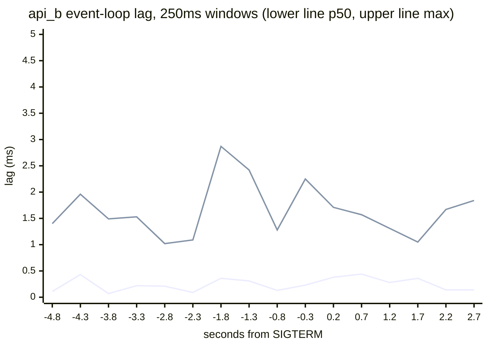

# Drill 23 — Shut down without dropping a request

**Status:** shipped

Card 23. Prereq 15. Branch `drill-23` (from `main` at `0ce8935`). Saved as
`plans/2026-10-11_drill-23-graceful-shutdown.md`.

## Context

Every deploy sends SIGTERM to a running API. Today `main.ts` calls `app.enableShutdownHooks()` and
nothing else. Nothing tells a load balancer to stop routing, nothing finishes keep-alive traffic,
and the import worker (drill 15) is not awaited by anything. The card asks for a measured
before/after: restart under sustained k6 load, count dropped requests, then build a drain with a
hard deadline. It also asks for an event-loop-lag graph and a decision on what health reports
while draining.

Facts from reading the code and probing:

1. **Nest's shutdown order (11.1.28, installed source):** `onModuleDestroy` → `beforeApplicationShutdown(signal)`
   → `dispose()` (`server.close()`, awaited) → `onApplicationShutdown` (pool and Redis close here)
   → `process.kill(pid, signal)`. Shutdown hooks run module by module, root-first. The order
   between two modules at the same depth is not something to rely on.
2. **`server.close()` does not stop keep-alive traffic (probed on Node 22.23).** After `close()`,
   an in-flight response still says `Connection: keep-alive`. The next request on that socket is
   still served. The close callback fired 6.5s later (keep-alive timeout 5s after the last
   request). Behind an LB that reuses connections, `close()` can wait until the container is
   SIGKILLed.
3. **One container cannot restart with zero errors.** Nothing answers while it is down. Zero
   errors needs two replicas behind a load balancer and a rolling restart.
4. **The dev container's PID 1 is `pnpm`**, then `nest start --watch`, then `node dist/main`.
   Whether SIGTERM reaches Node through that chain is unknown. It gets measured, not assumed.
5. **The import worker** (`ImportsService.detach`) is fire-and-forget. `pool.end()` during a
   batch makes the next `connect()` reject. Then `finish()` fails too, and the job stays
   `running`. That is the card's scenario. `import_jobs.status` has no CHECK constraint.
6. The `/health` route checks Postgres and Redis. Docker's healthcheck and `request-id.e2e-spec.ts` use it.
   `PROBE_ROUTES` already keeps `/health*` out of the logs.

## Decisions

1. **One arm switch, `SHUTDOWN=exit|nest|graceful`** (default `graceful`), exported from
   `health.service.ts`. It appears on `/info`, in compose, and in `check:arms`.
   - `exit`: `main.ts` registers no handler. Node's default SIGTERM disposition kills the process.
     This is "the process just exits".
   - `nest`: `enableShutdownHooks()` only. This is the code as shipped today.
   - `graceful`: the drain below.
2. **The drain lives in `HealthService.beforeApplicationShutdown(signal)`**, the Nest hook that runs
   before Nest closes the server. It runs only when `signal` is set and the arm is `graceful`.
   The e2e suites call `app.close()` without a signal, so they skip it. Sequence:
   1. Set `draining = true`. `GET /health` answers 503 `{status:'draining'}`.
   2. Wait `DRAIN_DELAY_MS` while still serving normally. This is the LB's detection window.
   3. Close the listener. From then on every response carries `Connection: close`. Call
      `closeIdleConnections()`. Wait for in-flight requests to reach 0.
   4. Nest continues: `dispose()` → `onApplicationShutdown` (pool, LISTEN clients, Redis) → exit.
   In-flight count and the `Connection: close` header come from one `prependListener('request')`
   on the Node server, reached through `HttpAdapterHost`. It is registered in `onApplicationBootstrap`.
3. **The import drains itself.** `ImportsService.beforeApplicationShutdown(signal)` sets
   `stopping`. `writeBatch` throws `interrupted by shutdown` before opening the next transaction.
   The batch in flight commits. `run()`'s existing catch writes `failed`, the error text and
   `resume_row`. The hook awaits every running job. Module order does not matter here: the pool
   closes only after every `beforeApplicationShutdown` hook has returned. A retry resumes from
   `resume_row` through the existing `POST /imports/:id/retry`. Auto-resume needs a lease or queue
   (card 30), and is recorded as a gap.
4. **Hard deadline in `main.ts`** (graceful only). On SIGTERM/SIGINT it arms an unref'd timer of
   `SHUTDOWN_TIMEOUT_MS`. When the timer fires, it logs `shutdown_deadline_exceeded` with in-flight
   count and phase, then calls `process.exit(1)`. It lives in `main.ts` because only the process
   owner may exit, and the e2e suite never runs `main.ts`. The live instrument proves it instead.
   The replicas' `stop_grace_period` MUST exceed it, or Docker's SIGKILL wins.
5. **Health.** `GET /health` is readiness: 503 while draining, otherwise the existing dependency
   check. New `GET /health/live` is liveness. It answers 200 while draining, checks no dependency,
   and reports `draining` and the event-loop window. Readiness failing pulls the replica from
   rotation. Liveness failing would get it SIGKILLed mid-drain.
6. **Event-loop lag.** `HealthService` runs `monitorEventLoopDelay` and closes a window every
   `EVENT_LOOP_LOG_MS || 1000` ms (p50, p99, max). When `EVENT_LOOP_LOG_MS > 0` it logs each window
   as `event_loop` with `inFlight` and `phase`. Logs are the only channel that survives the
   listener closing. Default 0, so normal runs log nothing.
7. **Measurement topology, `profiles: ['drain']`:** `api_a`, `api_b` and `lb`.
   - `api_a`/`api_b` `extends: nest_server`. They run `node apps/backend/dist/main` directly, with
     `init: true` (tini forwards the signal) and `stop_grace_period: 30s`. Ports are `!reset`.
     The Docker healthcheck is `/health/live`. Both share a named volume on `/tmp/imports`, so
     either replica can resume the other's import. `dist/` comes from the dev server's build.
   - `lb`: `haproxy:3.4.6-alpine` (pinned, newest LTS). `haproxy/haproxy.cfg` uses roundrobin with
     an active check `GET /health` at `inter 1s fall 2 rise 2`. It sets **`retries 0`** with no
     redispatch, so the LB never hides an app failure. It adds `x-served-by` from `%[srv_name]`
     and logs only abnormal sessions (termination codes like `SC`/`SH` say who closed what).
     Published on `:8080`. The stats page on `:8404` lets the instrument see UP/DOWN.
8. **Load: `k6/drain.ts` (`pnpm load drain`), open model.** constant-arrival-rate at `--rate`
   against `http://lb:8080`. The mix, chosen by iteration:
   - 6/10 `GET /conversations?pageSize=20`, orgs 2–10
   - 2/10 `GET /messages/search?q=export&limit=20`, orgs 2–10
   - 2/10 `POST /ingest`, org 1 (pro, unlimited), events `k6-drain-*`, so the cleanup SQL in
     `progress.md` applies
   Each failure is `console.log`ged as one JSON line (`t`, endpoint, status, `error_code`,
   `x-served-by`) into `failures.ndjson` in the report directory (`--log-format raw
   --log-output file=`). The summary adds errors by status and by endpoint. The error threshold is
   loosened so a broken arm reports instead of aborting.
9. **Orchestrator: `scripts/drain.ts` (`pnpm drain`).** It runs on the host because it calls
   Docker, the same as `scripts/load.ts`. Steps:
   1. `up -d --no-deps api_a api_b lb` with the arm env and `EVENT_LOOP_LOG_MS=250`. Wait until
      both servers are UP.
   2. Record `/info` arms from each replica.
   3. Spawn `node scripts/load.ts drain …` and read its report directory.
   4. Upload a generated CSV (`--rows`, same header as `db/import.mts`) through the LB, then read
      `x-served-by`.
   5. Rolling restart: `docker restart` the import's replica, wait for UP, wait 10s, restart the
      other.
   6. After k6 ends, read the job. If interrupted, retry it and verify `rows_written +
      rows_skipped = rows`.
   7. Parse `docker compose logs -t` (pino `event_loop`/`drain_*`, HAProxy state changes and
      errors).
   8. Write `drain.txt` (timeline, errors per second, import outcome, SIGTERM→exit per replica) and
      `timeline.json` into the same report dir. Print a mermaid `xychart-beta` of lag per window.
   `--slow` fires one uncached whale `GET /messages/stats` (~3s) during the drain delay. Paired with
   a short `SHUTDOWN_TIMEOUT_MS`, it demonstrates the deadline.
10. **Deadline numbers are decided by measurement, then defaulted.** `DRAIN_DELAY_MS` must be at
    least the measured SIGTERM→LB-DOWN time × 1.5. `SHUTDOWN_TIMEOUT_MS` = delay + the longest
    measured request or batch × 2, rounded up. `stop_grace_period` sits above it. The provisional
    values are 3000 and 10000. The write-up shows the arithmetic.

## What ships

**Edits**
- `src/main.ts`: arm-dependent `enableShutdownHooks()`, deadline timer.
- `src/health/health.service.ts`, `health.controller.ts`, `health.module.ts`: knobs, draining
  state, request listener, drain hook, lag windows, `/health/live`.
- `src/imports/imports.service.ts`: `stopping`, running-job set, `beforeApplicationShutdown`.
- `src/info/info.controller.ts` + `test/arms.e2e-spec.ts`: `shutdown`, `drainDelayMs`,
  `shutdownTimeoutMs`, `eventLoopLogMs`.
- `docker-compose.yml`: four env vars on `nest_server`, the `drain` profile services, the named
  volume. `.env.example`.
- Root `package.json`: `drain`, `db:test:nodrain`. `scripts/load.ts` catalog: `drain`.
  `.gitignore`: `k6/reports/**/failures.ndjson` only if large.

**New**
- `haproxy/haproxy.cfg`, `k6/drain.ts`, `scripts/drain.ts`.
- `test/shutdown.e2e-spec.ts` (calls the hooks directly; `close()` is typed without a signal):
  1. While draining, `/health` is 503 `draining` and `/health/live` is 200.
  2. A request in flight when the listener closes finishes 200 with `Connection: close`.
  3. A keep-alive socket gets `Connection: close` on its next response after close.
  4. A running import stops at a batch boundary: `failed`, error `interrupted by shutdown`,
     `resume_row` a multiple of the batch size. A retry lands exactly N rows.
  Red run: `db:test:nodrain` (`SHUTDOWN=nest`) MUST fail exactly these 4.

## Predictions, recorded before measuring

1. `exit`: every request in flight on the killed replica fails, and so does every new connection
   until HAProxy marks it DOWN (≈2s × half the traffic). Expect roughly 100–300 errors per
   restart, and the import stuck `running`.
2. `nest`: in-flight requests finish. New connections are refused for ~2s, and keep-alive races
   produce `SH`/`SC` 503s. The close drags on for seconds after DOWN, and the import is stuck
   `running`. Fewer errors than `exit`, not zero.
3. `graceful`: 0 errors on two consecutive runs. SIGTERM→exit ≈ `DRAIN_DELAY_MS` + <500ms. The
   import ends `failed`/interrupted at a batch boundary and a retry completes exactly.
4. Lag p99 at steady state stays under 20ms and falls during the drain as load leaves. The drain
   itself never blocks the loop. A blocked loop would also block the deadline timer, which is why
   Docker's SIGKILL stays the real backstop.
5. `docker compose restart nest_server` takes ~10s because SIGTERM never reaches Node.

## Measurement

The stack in use is this worktree's (`drills` project). Every compose call names only its own
services and uses `--no-deps`.

1. Probe the dev container's signal path: time a restart and read the logs for Nest's shutdown.
2. Calibrate: one replica alone, find the rate it serves at p99 < 500ms. Run at ~50% of that, so
   one replica carries everything mid-restart.
3. Measure SIGTERM→DOWN and the longest request or batch, then set the two defaults.
4. Interleaved in one sitting: `exit`, `nest`, `graceful`, `graceful`. Each is a full rolling
   restart of both replicas, with an import running on the first.
5. Deadline demo: `graceful` + `SHUTDOWN_TIMEOUT_MS=4000 --slow`. Expected: exit code 1, one
   abandoned request as a 502, and the log listing it.
6. `pnpm db:test` green, `db:test:nodrain` red 4, `pnpm test:ui` green. Afterwards remove
   `api_a`/`api_b`/`lb` and the drain volume. Clean up the `k6-drain-*` rows.

## Stretch (only on your go): backpressure

`MAX_IN_FLIGHT` per replica. The excess gets 503 + `Retry-After: 1` from the same in-flight
counter, in middleware. Overload at ~2× one replica's capacity, and compare p99 and errors with
and without the bound.

## Write-up and guide

The plan's Results and Write-up answer the card's three questions: the deadline and its basis,
what readiness says while draining and what breaks if it stays OK, and what Cloudflare Workers did
for free (no process lifecycle, old isolates finish in-flight requests, `ctx.waitUntil`, no pool
to close, edge routing with no health checks).

`drills/23-graceful-shutdown.md` (gitignored) is drafted in the worktree and copied to the main
checkout. It contains: ELI5, a sequence diagram of SIGTERM → readiness → LB DOWN → close → drain →
exit, the lag graph, every command with its result, the keep-alive probe, a tech stack cheat sheet
(Node signals and PID 1, `server.close` vs keep-alive, Nest lifecycle order, HAProxy checks,
k6 open model), `Is this production ready?`, `Honest gaps`, and `What I'd do differently at 10x`.

## Memory bank compaction (end of drill)

This is a removal pass under the skill's budgets. `history.md` is 5,258 words; older rows get
compressed to their outcome plus one constraint. `progress.md` sits at 1,498/1,500 words; resolved
or stale items get pruned. `techContext.md` gains the shutdown contract. Verified facts are written
directly. Anything that removes a judgment or open decision gets proposed to you first.

## Workflow

1. `git switch -c drill-23`. Write the plan file and the `planned` history row, then commit.
2. Commits: health + drain + import drain + tests → compose/HAProxy/k6/orchestrator.
3. Measure, then record results in the plan.
4. Guide; README row.
5. `pnpm format`, `pnpm lint`, `pnpm typecheck`, `pnpm check:arms`.
6. Memory bank update + compaction. History row → `implemented`.
7. PR, then the `drill/23` release (0.23.0), tagged on the branch before the merge.

## Verification

- `curl -si localhost:8080/health` shows `x-served-by` alternating between a and b.
- `docker kill -s TERM drills_api_a`, then `/health` on that replica returns 503 `draining`
  within ms, and HAProxy's stats page shows it DOWN within ~2s.
- `pnpm drain --arm graceful` twice: 0 errors in both summaries and an empty `failures.ndjson`.
- `pnpm drain --arm exit` and `--arm nest`: nonzero errors with timestamps clustered at each
  SIGTERM.
- `pnpm db:test` green, `db:test:nodrain` red exactly 4, and `pnpm arms` shows the shutdown knobs.

## Revised while shipping

- `health.module.ts` needed no edit. `HttpAdapterHost` is global.
- `SHUTDOWN_TIMEOUT_MS` defaults to 15000, from Decision 10's rule: 3s + 2 × 4.67s (the uncached
  whale stats under load), rounded up. `DRAIN_DELAY_MS` stays 3000 (≥ 1.5 × 1.93s).
- `scripts/load.ts` gained a per-script `env` hook (k6's log file in the run directory) and
  `INFO_URL` (arms from the LB, not `nest_server`).
- `pnpm drain` waits for each replica's own `/health` before trusting HAProxy. A restart faster than
  `fall × inter` never shows as DOWN, so the LB's UP was stale twice.
- `pnpm drain` streams `docker events` live. The daemon's event ring overflows with health-check
  execs in ~90s.
- `--slow` takes `stats` (a ~4.7s whale scan) or `trickle` (an 8s upload with no DB load). The stats
  variant produced a cascade unrelated to the deadline (finding 6), so the clean deadline demo uses
  `trickle`.
- `test:e2e` runs `--maxWorkers=6` (your call). Jest's default 13 workers OOM-killed the 1GB dev
  container once the suite grew to 16; it passed 161/161 at 6.
- The shutdown suite deletes messages by `conversation_id`. By `org_id` it scans 10M rows and broke
  the 5s hook timeout.

## Results

Docker Desktop, 14 CPUs. Two replicas at the default pool of 10 behind HAProxy 3.4.6. Open model,
150 req/s (`list:search:ingest 6:2:2`, orgs 2–10, ingest on org 1), warm-up 15s, measured 75s.
A 300,000-row import starts on the first replica 6s before its SIGTERM. Rolling restart: SIGTERM
the import's replica, wait for it to be ready and UP, wait 10s, then the other. Reports are in
`k6/reports/2026-10-11-*-drain-*/drain.txt`.

**Calibration (one replica alone, 30s):** 100 req/s p99 89ms; 200 req/s p99 79ms; 300 req/s p99
614ms with 101 dropped iterations. The knee is ~250, so 150 leaves one replica ~40% headroom.

| Run | Arm | Rate | Failed | p99 | Import after the restart | SIGTERM → exit (a / b) |
|---|---|---|---|---|---|---|
| `exit` | exit | 150 | **211** (503 `SC--`) | 100.65ms | stuck `running` at 68,000 | 0.08 / 0.49s |
| `nest` | nest | 150 | **0** | 90.78ms | stuck `running` at 223,000 | 8.03 / 7.39s |
| `graceful-1` | graceful | 150 | **0** | 70.16ms | failed at 101,000 → retry 300,000 of 300,000 | 3.08 / 3.20s |
| `graceful-2` | graceful | 150 | **0** | 68.95ms | failed at 103,000 → retry 300,000 of 300,000 | 3.10 / 3.26s |
| `nest-250` | nest | 250 | **132** (503 `SC--`) | 291.61ms | stuck `running` at 196,000 | 7.43 / 8.05s |
| `graceful-250` | graceful | 250 | **0** | 311.17ms | failed at 91,000 → retry 300,000 | 3.09 / 3.21s |
| `deadline-4s-trickle` | graceful, 4s | 150 | **0** | 68.58ms | failed at 95,000 → retry 300,000 | 4.25 (exit 1) / 3.09s |
| `deadline-4s` (`--slow stats`) | graceful, 4s | 150 | **535** (125 × 500, 410 × 503) | 2002ms | failed at 90,000 → retry 300,000 | 5.11 (exit 1) / 3.55s |
| `deadline-4s-rerun` | graceful, 4s | 150 | **203** (503) | 1751ms | failed at 89,000 → retry 300,000 | 4.38 (exit 1) / 3.12s |

Dropped iterations were 0 on every 150 req/s run except the two stats cascades (171, 178). The
250 req/s runs dropped 15 (graceful) and 23 (nest) while one replica carried 250 alone.

**Timings across the twelve graceful drains:** SIGTERM → HAProxy DOWN 1.20–1.93s (bound: `inter 1s ×
fall 2`). Listener closed at 3.00–3.06s. Exit at 3.08–3.55s (3.08–3.26s outside the cascade). Restart → UP 1.69–2.81s (Node boot plus
`rise 2`). The import stopped within 11–206ms (one batch) at a 1,000-row boundary every time.

**Event-loop lag (250ms windows, resolution subtracted):** p50 0.0–2.4ms and max mostly under 15ms
before and during every drain, with or without the import. Single windows hit 20–30ms (boot, GC).
During the stats cascade, `b`'s in-flight count climbed 2 → 218 while its lag max stayed 0.4–4.4ms.

### Findings

1. **`exit`: the LB never noticed.** The replica died and booted again within ~1.5s, inside HAProxy's
   `fall 2 × inter 1s`, so it stayed UP and half the traffic hit a refusing port. 211 × `SC--`,
   i.e. ≈ 75 req/s × the 1.2–1.9s outage. No request in flight was cut (0 × `SH--`): at ~1–2 in
   flight per replica, none happened to be mid-response.
2. **`nest` is not graceful, and at 150 req/s it still dropped nothing.** `close()` refused new
   connections. HAProxy's health checks open new connections, got refused, and marked the replica DOWN in
   1.0–1.9s. Real traffic rode HAProxy's pooled keep-alive connections, which Node 22 keeps serving
   after `close()`. Exit then waited for those sockets to idle out: 7.4–8.1s. At 250 req/s HAProxy
   needed new server connections before DOWN: 132 × 503. The arm also abandons the import (finding 4).
3. **`graceful`: 0 failed requests in four rolling restarts** (two at 150, one at 250, one with an
   abandoned request). Readiness flips at SIGTERM, the LB drops the replica within 1.93s, and the
   listener closes at 3.0s with nothing left to refuse.
4. **The import.** `exit` and `nest` leave the job `running` with no worker. `retry` refuses a
   running job, so it stays that way. `graceful` stops at the batch boundary: `failed`,
   `interrupted by shutdown`, `resume_row` a multiple of 1,000. One retry on the other replica landed
   exactly 300,000 every time.
5. **The deadline does what it says.** A trickle upload still open at 4s: `shutdown_deadline_exceeded
   inFlight=1` at 3.999s, exit code 1 at 4.25s, 0 collateral errors.
6. **Readiness that checks Postgres through the request pool causes a full outage.** One uncached whale
   stats scan (~4.7s) started while `a` drained. `b` carried 150 req/s alone with Postgres I/O taken
   by the scan. Its in-flight count climbed to 218, its pool timed out (125 × 500), and `/health`'s
   `SELECT 1` waited in the same pool queue. HAProxy marked `b` DOWN with `Layer7 timeout, check
   duration: 1000ms … 0 active servers left`. Then 410 × 503 came from the LB itself. It reproduced
   (203 × 503). The control is the same scan with both replicas serving: 0 errors, p99 527ms.
7. **Event-loop lag is not this service's overload signal.** The work is I/O. A queue of 218
   requests waiting on Postgres left the loop idle. In-flight count and pool wait show overload;
   lag shows CPU blocking only.
8. **Side finding: deleting conversations is O(rows × usage_events).** `usage_events.conversation_id`
   (`ON DELETE SET NULL`) has no index, so each deleted conversation scans the ledger. A 2.96M-row
   cleanup ran 7m55s before it was cancelled. With FK triggers off it took 1.18s.
9. **Prediction 5 was wrong.** `pnpm` → `nest start --watch` → Node does forward SIGTERM. A 3.3s
   request finished 200 and `docker compose stop` waited 2.4s for it.

### Lag around SIGTERM (`graceful-1`, api_b, import running)

Every second window from `drain.txt`. SIGTERM at 0, LB DOWN at 1.76s, listener closed at 3.01s.

## Write-up

**What's your drain deadline and what did you base it on?** 15s from the signal, in three parts.
`DRAIN_DELAY_MS = 3000` covers the LB's detection window: HAProxy needs `fall 2 × inter 1s`, and
the measured worst was 1.93s, so 1.5× is 2.9s. The in-flight drain covers the slowest legitimate
request: the uncached whale stats aggregate ran 4.67s under load, and 2× that is 9.3s. The import
needs one batch (≤206ms), so it does not move the number. 3 + 9.3 = 12.3, rounded up to 15. Docker's
`stop_grace_period` is 30s, so the app's own deadline fires first and logs what it abandoned. Past
the deadline the process logs `shutdown_deadline_exceeded` with in-flight count and phase, then
exits 1. Open requests are cut, and a running import stays `running` (a lease would fix that,
card 30).

**What must readiness say during the drain, and what breaks if it keeps saying OK?** 503 from the
first moment of SIGTERM, while the process keeps serving everything already routed to it. If it
keeps saying OK, the LB learns about the shutdown only when connections fail. With `exit` that
meant 211 refused requests. With `nest` it meant 132 at 250 req/s, because HAProxy needed new
connections before its checks hit the closed listener. Liveness must keep saying OK, or the
orchestrator kills the drain it is waiting for. The measured corollary runs the other way:
readiness must not fail for reasons the instance cannot fix. Checking Postgres through the request
pool turned one slow query into "no servers available" (finding 6), so readiness now answers from
local state alone (the follow-up below).

**What did the Cloudflare runtime do for you that you just had to build by hand?** Workers have no
process to signal. A deploy routes new requests to the new version while old isolates finish their
in-flight requests, so readiness, detection delay, listener close and keep-alive handling are not
your code. `ctx.waitUntil` extends a request past its response, which is the job the import drain
does here. There is no pool to close (Hyperdrive pools connections at the edge), no PID 1, no
`stop_grace_period`, and no load balancer health check to tune. Nothing boots beside the traffic either: an isolate starts
inside the request that needs it. What it did not do is drain long background work: a Worker's CPU and
duration limits mean a 40-minute import was always a queue's job there.

## Follow-up: readiness from local state (approved after the write-up)

Finding 6 showed readiness doing harm. `GET /health` ran `SELECT 1` through the request pool, so an
overloaded replica failed its check, and the LB removed the last server.

**Decision.** Readiness answers from this process's own state only: 200 while `serving`, 503 while
draining. It never touches the pool, Postgres or Redis, and answers synchronously. Pool saturation
stays out too, because every replica saturates together under global overload. Overload is the
backpressure stretch's job (503 + `Retry-After` per request), not routing's.

- `READINESS=local|deps` (default `local`). `deps` is the shipped behaviour, kept as the control arm.
  It appears on `/info`, in compose, and in `check:arms`.
- `GET /health/deps` keeps the dependency report (503 if one is down) for people and alerts. Nothing
  routes on it.
- New `test/health.e2e-spec.ts`: with every pool connection held, `GET /health` answers 200 in
  under 500ms, and `GET /health/deps` answers 503 with Postgres down. Red run `db:test:readydeps`
  (`READINESS=deps`) MUST fail exactly the readiness test.
- `pnpm drain --readiness deps|local` passes the arm through.

**Prediction.** `--slow stats --deadline-ms 4000`, interleaved `local, deps, local, deps`: `deps`
reproduces the cascade (hundreds of LB 503s). `local` keeps `b` UP: zero LB 503s, and only the
500s from `b`'s pool timeouts remain (0–130). One plain `graceful` run on `local` stays at 0.

### Follow-up results

Same scenario as finding 6: `pnpm drain --arm graceful --deadline-ms 4000 --slow stats`, 150 req/s,
interleaved by `--readiness`, cache warmed by a 70s load first. `drain.txt` now prints failures
before the first SIGTERM (a run counts only at 0) and the LB's own "no server" 503s.

| Run | Readiness | Failed | LB had no server | Survivor marked DOWN mid-drain |
|---|---|---|---|---|
| `cascade-deps-2` | deps | 322 | 303 × 503 | yes, `Layer7 timeout, 1000ms` |
| `cascade-local-2` | local | 12 (500) | 0 | no |
| `cascade-deps-3` | deps | 5 (500) | 0 | no |
| `cascade-local-3` | local | 28 (500) | 0 | no |
| `cascade-deps-4` | deps | 412 | 344 × 503 | yes, `Layer7 timeout, 1001ms` |
| `cascade-local-4` | local | 52 (500) | 0 | no |
| `graceful-local` (no slow request) | local | 0 | 0 | no; the import resumed to 300,000 |

With the two earlier `deps` runs (535 and 203 failed), `deps` lost its last server in 4 of 5 runs.
`local` lost it in 0 of 3. The 12–52 failures left on `local` are `b`'s 2s pool-acquire timeouts
while it carried 150 req/s alone during the scan: overload, which readiness should not hide and
backpressure would shed. `cascade-local-1` is excluded: it failed 3,016 requests on both replicas
from 22s before any SIGTERM (a cold cache right after a 3M-row cleanup), so it measured something
else. That is why the validity line exists.

The prediction held: `local` had zero LB 503s and 12–52 pool-timeout 500s, inside the predicted
0–130.
